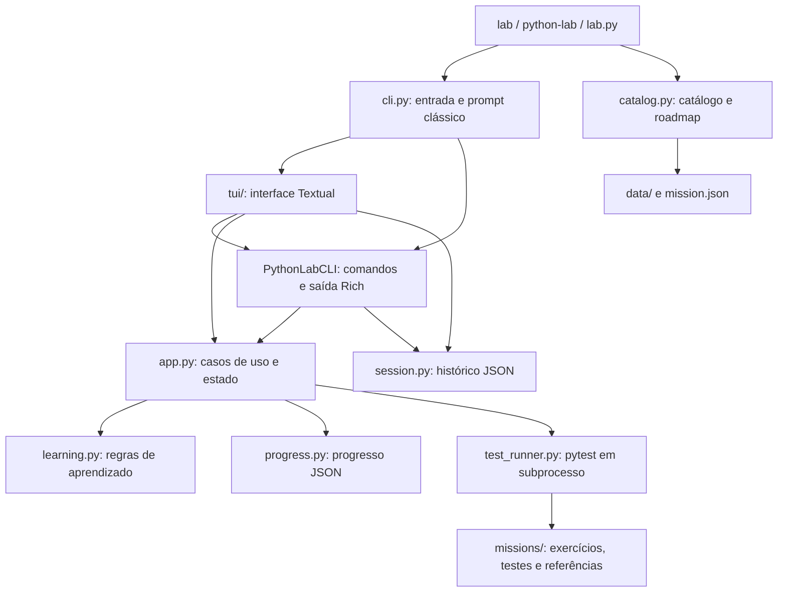

# Auditoria histórica do Python Lab — 9 de outubro de 2026

> **Escopo histórico:** a auditoria abaixo descreve somente o commit
> `d7a890458ec072aee7ee6ab17d2d24a621f9de2a`. O relatório e o diagnóstico foram
> adicionados em `c6c9fd7b53c1bf21c0f4b6ddee29bd664d999483`, após a auditoria.
> Os 123 testes, números de linhas e medições abaixo pertencem àquele snapshot;
> não representam a suíte, performance ou arquitetura atuais. O restante do
> texto preserva os achados e as propostas originais como registro histórico.

## Status dos achados em `5360804`

Esta tabela descreve o código em `53608044ce15ac65fbbbfb8803e7645f6da04a6e`,
antecessor das correções de feedback do PR #4. Os links apontam para os módulos
e as regressões mantidos no checkout; os resultados de testes atuais devem ser
consultados na CI e no relatório de validação do PR, não nos números históricos abaixo.

| ID | Status nesse snapshot | Implementação e regressão atual |
| --- | --- | --- |
| R1 | Corrigido: sessões e eventos são transacionais em SQLite; instâncias intercaladas preservam ambas as sessões. | [session.py](../../python_lab/session.py); [test_session_interleaving_preserves_both](../../tests/test_storage_concurrency.py), [test_session_retention_reserves_total_capacity_for_all_open_sessions](../../tests/test_final_review_regressions.py). |
| R2 | Corrigido: payload e revisão vêm da mesma leitura; `BEGIN IMMEDIATE` e compare-and-swap rejeitam writers desatualizados. | [progress.py](../../python_lab/progress.py); [test_simultaneous_progress_writers](../../tests/test_storage_concurrency.py), [test_concurrent_repository_save_is_rejected_without_overwriting](../../tests/test_progress.py). |
| R3 | Corrigido: a explicação vazia na TUI não lê stdin nem conclui a missão. | [tui/app.py](../../python_lab/tui/app.py); [test_blank_explanation_never_reads_stdin](../../tests/test_tui.py). |
| R4 | Corrigido: falhas de histórico ficam visíveis e permitem continuar/encerrar sem recursão no log. | [cli.py](../../python_lab/cli.py), [tui/app.py](../../python_lab/tui/app.py); [test_history_and_close_failures_allow_exit](../../tests/test_cli.py), [test_tui_history_failures_remain_visible_and_allow_exit](../../tests/test_tui.py), [test_session_start_failure_keeps_classic_available](../../tests/test_cli_entrypoint.py). |
| R5 | Corrigido: codecs normalizam UTF-8/JSON/tipos inválidos em erros de domínio; missão ativa removida tem erro acionável; migração explícita preserva backups. | [storage/codecs.py](../../python_lab/storage/codecs.py), [storage/migration.py](../../python_lab/storage/migration.py); [test_invalid_mission_fields_are_domain_errors](../../tests/test_state_codecs.py), [test_invalid_utf8_is_a_domain_error](../../tests/test_state_codecs.py), [test_removed_active_mission_is_actionable](../../tests/test_cli.py), [regressões de migração](../../tests/test_state_migration.py). |
| R6 | Corrigido: runner gerencia grupos POSIX e Job Objects Windows e espera a limpeza de descendentes no timeout/cancelamento. | [runtime/processes.py](../../python_lab/runtime/processes.py), [runtime/windows.py](../../python_lab/runtime/windows.py); [test_timeout_stops_descendants](../../tests/test_process_runner.py), [test_cancel_stops_descendants](../../tests/test_process_runner.py), [regressões Windows](../../tests/test_windows_job.py). |
| R7 | Corrigido: IDs duplicados e `future` não booleano são rejeitados; referências de skills são validadas antes de carregar estado. | [catalog.py](../../python_lab/catalog.py), [app.py](../../python_lab/app.py); [test_duplicate_skill_is_rejected](../../tests/test_catalog.py), [test_skill_future_requires_boolean](../../tests/test_catalog.py), [test_unknown_mission_skill_is_rejected_before_loading_state](../../tests/test_catalog.py). |

O diagnóstico antigo foi removido do checkout corrente: dependia de
`ProgressRepository._current_revision`, que não existe na API SQLite. A leitura
desse atributo lança `AttributeError`; monkeypatches no método antigo não
exercitam o controle de revisão atual. A suíte regular acima substitui os probes.
O [script histórico](https://github.com/14lucas-mendes/python-lab/blob/c6c9fd7b53c1bf21c0f4b6ddee29bd664d999483/docs/reviews/reproduce_findings.py)
permanece disponível no commit que o introduziu, apenas para consultar a evidência original.

## Registro original da auditoria de `d7a8904`

O Lab tem uma boa base para uso pessoal: regras de aprendizado separadas da interface, gravação atômica de JSON, verificação de alterações na solução e testes funcionais da TUI. A prioridade para uma release local robusta é proteger os dados quando duas instâncias estão abertas e tratar falhas de entrada/saída sem derrubar a sessão. A suíte daquele snapshot passa, mas não cobre os problemas reproduzidos abaixo.

## Escopo e evidência

- Commit analisado: `d7a890458ec072aee7ee6ab17d2d24a621f9de2a`, correspondente a `main` no início da revisão.
- Plataforma executada: Linux, Python 3.12.14, Rich 14.3.4, Textual 0.89.1, pytest 8.4.2; instalação editável com o extra `dev`.
- Resultado da suíte existente: **123 aprovados, 0 falhas, 0 erros, 0 ignorados**, em aproximadamente 21 segundos. Inclui referências das 11 missões e jornadas reais das missões 001/006 em TUI de 80×24 e 120×40.
- Revisão de `python_lab/`, catálogo/dados, testes, manifesto, README e script PowerShell; reproduções de concorrência, erros de estado, comandos e timeout em diretórios temporários.
- Esta PR entrega análise e diagnósticos. O comportamento do aplicativo e as soluções dos exercícios não são alterados.
- Windows/PowerShell, Python 3.11 e outras versões não foram executados nesta revisão. As observações sobre o script Windows são de análise estática. Não foi realizado teste com pessoas, leitor de tela ou carga multiusuário.

“Produção” aqui significa inicialmente distribuir e operar um aplicativo local confiável. Hospedar soluções de terceiros em um serviço exige um modelo de segurança adicional; não se presume que esse seja o objetivo atual. A falta de suporte a wheel é uma limitação explicitamente documentada no README, e não uma regressão da instalação editável suportada.

## Estrutura e arquitetura



| Parte | Responsabilidade | Avaliação |
| --- | --- | --- |
| [models.py](../../python_lab/models.py) | Dataclasses do domínio | Pequeno e legível; históricos/evidências ainda são dicionários sem contrato completo. |
| [catalog.py](../../python_lab/catalog.py) | Carregar objetivos, skills, missões e roteiro | Boa validação de IDs de missões, pré-requisitos e ciclos; validação das skills é menos rigorosa. |
| [learning.py](../../python_lab/learning.py) | Desbloqueio, pistas, conclusão e evidências | Regras concentradas e testáveis; pode expor uma única função para validar o plano. |
| [app.py](../../python_lab/app.py) | Orquestração e estado da aplicação | Evita acoplar o domínio ao terminal; rollback de progresso em falha de persistência é útil. |
| [progress.py](../../python_lab/progress.py), [session.py](../../python_lab/session.py) | Estado persistido | `fsync` e `os.replace` protegem contra arquivos parcialmente gravados; não protegem contra atualização perdida. |
| [cli.py](../../python_lab/cli.py), [tui/](../../python_lab/tui) | Entrada, renderização e interação | A TUI reaproveita comandos da CLI, mas também os intercepta e acessa APIs privadas. Isso cria caminhos diferentes para erro e entrada. |
| [test_runner.py](../../python_lab/test_runner.py) | Executar e interpretar pytest | Usa o interpretador atual, verifica JUnit e rejeita suites vazias/ignoradas; faltam limites para descendentes e volume de saída. |

Não há necessidade demonstrada de microserviços ou de uma grande reescrita. A separação existente permite melhorar persistência, comandos e runner em mudanças pequenas.

## Achados priorizados

Alta indica perda de dados do usuário em condições descritas; média indica quebra de interação, tratamento de erro ou isolamento operacional. As prioridades são propostas para o backlog, não incidentes já observados em usuários.

| ID | Prioridade | Condição concreta | Efeito | Evidência |
| --- | --- | --- | --- | --- |
| R1 | Alta | Duas instâncias de `SessionLog` abertas | Uma gravação da primeira remove a sessão da segunda | Reprodução sem concorrência de threads: 2 sessões → 1. |
| R2 | Alta | Dois writers de progresso ou escrita durante `load` | Atualização aceita pode apagar missões do outro writer | Dois cenários determinísticos, detalhados abaixo. |
| R3 | Média | Enviar explicação vazia na TUI | Aciona leitura de stdin do prompt clássico | `Console.input("Explicação final: ")` foi chamado pelo modal. |
| R4 | Média | Falha ao gravar histórico durante um comando | `SessionError` escapa do dispatcher | Erro injetado em `record` durante `/status`. |
| R5 | Média | Estado inválido ou missão ativa removida do catálogo | Exceções fora do contrato de erro do aplicativo | `UnicodeDecodeError`, `TypeError` e erro no banner com missão removida. |
| R6 | Média | Um teste inicia subprocesso e excede timeout | Processo filho continua executando | Marker criado pelo filho depois do retorno de timeout. |
| R7 | Baixa | Skills com ID duplicado ou `future: "false"` | Catálogo perde uma skill ou muda seu estado | Dois IDs iguais → um; string `"false"` → `True`. |

### R1 — O histórico é sobrescrito por outra instância

**Local:** [session.py](../../python_lab/session.py), `start` (39–50), `record` (52–68), `_save` (95–116).

Cada instância guarda uma cópia de todas as sessões em memória e a grava inteira. Abra A, abra B, depois registre um comando em A: A salva sua cópia anterior e apaga B. `os.replace` garante um arquivo íntegro, mas o conteúdo continua desatualizado. O limite de 20 sessões/200 eventos não resolve essa perda.

**Melhoria:** bloquear a operação completa de ler/atualizar/gravar e mesclar por ID da sessão, ou persistir sessões/eventos em transações SQLite. Um lock apenas no rename não basta. Se a primeira release limitar o aplicativo a uma instância, adquirir esse lock antes de abrir ambos os repositórios e explicar o impedimento ao usuário.

**Aceite:** se houver suporte a concorrência, duas instâncias intercalam start/record/close sem perder IDs nem eventos. Na política de instância única, a segunda abertura é recusada explicitamente e preserva todos os dados. Falha de gravação preserva o último estado válido.

### R2 — O controle de revisão do progresso tem janelas de corrida

**Local:** [progress.py](../../python_lab/progress.py), `load` (31–32, 87–88), `save` (99–123, 132–133).

Há dois problemas na relação entre estado e hash:

1. Dois writers podem ler a mesma revisão em `save`, ambos passar na comparação e depois substituir o arquivo. A reprodução posiciona uma barreira imediatamente após a leitura do hash: ambos retornam sem erro e apenas uma das duas missões permanece.
2. `load` interpreta o texto lido e depois lê o arquivo outra vez para obter a revisão. Se outro writer salvar nesse intervalo, o objeto antigo fica associado ao hash novo. A reprodução carregou `001`, colocou `001/002` no disco antes do hash, e um `save` posterior removeu `002` sem conflito.

O teste `test_concurrent_repository_save_is_rejected_without_overwriting` cobre writers sequenciais. Não exercita essas janelas.

**Melhoria:** calcular a revisão dos mesmos bytes usados no parse; proteger a comparação e a substituição por um lock entre processos. Se adotar SQLite, usar revisão explícita e transação com compare-and-swap. A revisão pós-save também deve representar exatamente o conteúdo que a instância gravou.

**Aceite:** os dois interleavings acima preservam as atualizações ou produzem conflito explícito; nunca confirmam duas gravações incompatíveis. Na política de instância única, verificar também que a segunda abertura não chega a gravar progresso. O erro deve oferecer uma saída segura sem sobrescrever nem reinicializar o progresso.

### R3 — Explicação vazia cruza a fronteira entre TUI e stdin

**Local:** [tui/app.py](../../python_lab/tui/app.py), callback de `_open_explain` (287–297); [cli.py](../../python_lab/cli.py), `explain` (316–320).

Ao clicar em Concluir com texto vazio, o callback monta `/explain `; o parser remove o espaço e a CLI usa `console.input`. Na TUI, essa leitura síncrona compete com o terminal gerenciado pelo Textual e pode bloquear ou receber EOF. A reprodução intercepta essa leitura para não travar o diagnóstico.

**Melhoria:** validar texto vazio/whitespace no modal e mostrar erro junto ao campo. O comando de domínio deve receber um argumento explícito; somente o adaptador clássico deve solicitar texto pelo stdin.

**Aceite:** vazio, espaços e quebras de linha não leem stdin nem persistem explicação; o usuário mantém foco e texto no modal. Texto válido continua completando a missão conforme as regras atuais.

### R4 — Falhas de histórico escapam da proteção dos comandos

**Local:** [cli.py](../../python_lab/cli.py), `execute` (146–164); [tui/app.py](../../python_lab/tui/app.py), fallback (238) e `_record` (491–507).

O `try` protege o handler, mas o `record` posterior fica fora dele. Na própria captura de erro, há outra chamada ao mesmo `record`. Se `SessionLog.record` falhar por disco cheio, permissão ou diretório indisponível, `/status` lança `SessionError` para o chamador. A TUI tem um wrapper que notifica esse erro, mas os comandos delegados à CLI não usam o wrapper.

**Melhoria:** centralizar a política de log: comunicar que o histórico falhou, manter a sessão utilizável e não tentar registrar recursivamente o erro no mesmo destino. Distinguir “comando persistido” de “histórico não registrado”. Revisar também `action_quit_lab`, EOF e fechamento, onde erros de persistência não têm o mesmo tratamento dos handlers.

**Aceite:** `/status`, comandos desconhecidos, `/start` e encerramento com falha de log produzem mensagem útil sem traceback. Falha de progresso não é escondida por falha secundária de histórico.

### R5 — O estado carregado não tem validação completa e recuperável

**Local:** [progress.py](../../python_lab/progress.py), `load` (31–38, 57–83); [session.py](../../python_lab/session.py), `load` (25–37).

Bytes `0xff` escapam como `UnicodeDecodeError`, enquanto o bootstrap espera `ProgressError`/`SessionError`. O campo `status: []` é usado em um set antes de validar seu tipo e lança `TypeError`. Campos internos de histórico/evidências são apenas parcialmente verificados. Progresso com missão ativa removida do catálogo também é aceito, mas `_banner` lança `ApplicationError` fora do `try` de `main`; é necessário reconciliar esses dados na inicialização.

**Melhoria:** validar tipos antes de operações de conjunto, normalizar erros de decoding/I/O e criar versão do schema com migrações explícitas. Introduzir tipos para tentativa/evidência/evento e validar referências ao catálogo na inicialização. Oferecer backup/exportação e recuperação orientada, preservando o arquivo original inválido.

**Aceite:** fixtures com UTF-8 inválido, tipos errados, missão removida e schema antigo geram erro de domínio ou migração documentada. Nenhum desses casos apaga o arquivo para “corrigir” o problema.

### R6 — Timeout não encerra a árvore de processos do teste

**Local:** [test_runner.py](../../python_lab/test_runner.py), `run_tests` (95–133).

O timeout de `subprocess.run` encerra o processo direto. A reprodução usa um teste que inicia um filho e espera; pytest é encerrado, o runner retorna `-1`, mas o filho grava um arquivo depois. Isso pode deixar automações e recursos externos ativos após o Lab anunciar interrupção. O teste de loop infinito existente cobre o processo direto, não descendentes.

**Melhoria:** gerir um grupo de processos no POSIX e um mecanismo equivalente no Windows, com encerramento e espera da árvore inteira. Conectar cancelamento/saída da TUI ao runner. Testar o comportamento em ambas as plataformas em vez de assumir que uma implementação POSIX basta.

**Aceite:** timeout e cancelamento encerram um teste e seus filhos; nenhum marker aparece depois do encerramento. Cancelamento não transforma uma execução parcial em evidência aprovada.

### R7 — A validação das skills é inconsistente com a das missões

**Local:** [catalog.py](../../python_lab/catalog.py), `load_skills` (62–78).

O dicionário aceita sobrescrever um ID existente. `bool(item.get("future", False))` trata qualquer string não vazia como verdadeiro; `"false"` vira `True`. Além disso, o carregamento conjunto não verifica se todas as skills referenciadas pelas missões existem. Essas inconsistências podem surgir ao ampliar o catálogo.

**Melhoria:** rejeitar IDs duplicados, exigir bool JSON para `future` e validar referências de skills no bootstrap. Usar a mesma política de mensagens acionáveis já aplicada aos pré-requisitos.

**Aceite:** duplicação, `"false"`, números e referência desconhecida produzem `CatalogError`; o catálogo atual continua válido.

## Performance: medições históricas e risco de crescimento

As medições abaixo são amostras na máquina desta revisão, com caches quentes. Não são SLOs, percentis de produção nem comparações entre plataformas.

| Medida | Observação |
| --- | --- |
| Construção do app com 11 missões | Média de aproximadamente 2,3 ms em 20 chamadas; não inclui importação inicial nem desenho da TUI. |
| `_refresh_status` com referência 001 aprovada | **4 fingerprints completos por atualização**; aproximadamente 0,27 ms/atualização em 20 chamadas. |
| `ProgressRepository.save` sem histórico | JSON de 382 bytes; aproximadamente 0,15 ms, média de 3 gravações. |
| Mesmo save com 10.000 tentativas sintéticas | JSON de 2.580.388 bytes; aproximadamente 83 ms, média de 3 gravações. Não mede deepcopy do app ou desenho de widgets. |

Não há evidência de gargalo preocupante no fluxo atual. Há oportunidades antes de crescer:

- **Fingerprint repetido:** `_refresh_status` consulta a atualidade por `cycle_progress`, `next_step`, etapas e resultado. São quatro leituras quando há resultado aprovado em memória e três após reabrir progresso aprovado sem resultado em memória; o timer roda uma vez por segundo. Calcular um snapshot de status uma vez por atualização e compartilhá-lo. Para pacotes maiores, considerar detecção de alterações com invalidação conservadora; revalidar antes de concluir uma missão. Erros de leitura do fingerprint devem virar erro de domínio, especialmente no timer.
- **Histórico ilimitado:** `attempt_history`, evidências e `transcript_entries` crescem. O progresso inteiro é serializado, lido para hash e copiado a cada persistência. Definir retenção/exportação, paginar apresentação e medir o fluxo completo antes de escolher armazenamento incremental.
- **Saída ilimitada do runner:** `stdout=PIPE` coleta tudo em memória e mantém resultados por missão. Para programas verbosos, usar arquivo temporário/spool com limite de apresentação e link de acesso local aos detalhes; informar truncamento e preservar o estado real do teste.
- **Busca de missões:** lookup linear e reconstrução de índice em recomendações são aceitáveis para 11 missões. Só introduzir índice persistente quando medições com catálogo maior justificarem.

## Manutenção, duplicação e scripts

| Observação verificável | Sugestão de melhoria |
| --- | --- |
| CLI tem 546 linhas e TUI app 507; entrada, persistência de eventos, decisões e renderização se misturam. | Extrair um dispatcher de comandos que retorne resultados tipados; CLI e TUI cuidam de entrada e apresentação. Fazer extração por comportamento com testes existentes, sem criar um framework de plugins. |
| `cli.py` importa TUI, e TUI importa comandos/CLI dentro do construtor. | Mover catálogo de comandos e aliases para um módulo neutro; importar o adaptador necessário depois de interpretar argumentos. Isso simplifica o modo clássico e reduz dependência circular. |
| Verificação do plano aparece em learning, app, TUI e widgets. | Expor uma função pública de validação e reutilizá-la. Evitar implementações que divirjam sobre whitespace/campos faltantes. |
| Resultado é memorizado no app e novamente nos adaptadores; TUI mantém também `last_test_result`. | Definir o app como dono do resultado por missão e remover estado redundante gradualmente. |
| Versão `0.3.0` aparece no manifesto, parser da CLI e TUI. | Usar metadados do pacote como fonte única e testar consistência. |
| `HelpScreen`/`HELP_TEXT` não são chamados pelo fluxo atual; `start_mission` recebe `missions` sem usá-lo. | Remover caminhos mortos ou ligá-los a um comportamento documentado; corrigir indentação extra em `reveal_hint`. São prioridades de limpeza, sem impacto funcional comprovado. |
| Adaptadores consultam `SessionLog._current` diretamente. | Expor propriedades/métodos de ciclo de vida e concentrar encerramento idempotente em uma API pública. |
| [install-lab.ps1](../../scripts/install-lab.ps1) termina com executável nativo, sem verificar `$LASTEXITCODE`. | Validar o executável antes de alterar PATH e propagar falha nativa. `$ErrorActionPreference = "Stop"` sozinho não garante essa propagação em todas as versões de PowerShell. Validar em Windows; não foi reproduzido nesta máquina. |

## CLI/TUI e distribuição

A suíte exercita navegação por teclado, rolagem, resize, Unicode, pistas, plano multilinha e uma jornada completa. Essa é uma base importante de regressão. O modal vazio R3 e a política de falhas R4 devem entrar nessa mesma cobertura.

Para a próxima release local:

1. **Diretório de dados explícito:** `build_app` usa a raiz do pacote/checkout para catálogo e estado. O padrão grava em `data/progress.json` versionado, embora o README peça para não versionar progresso real. Separar catálogo imutável e estado do usuário; oferecer `--data-dir` com padrão apropriado à plataforma e migração/backup. O lançador externo da configuração da nuvem contorna isso, mas não é uma funcionalidade do repositório.
2. **Comandos automatizáveis:** os flags externos hoje são help/version/classic. Quando scripts forem um objetivo, adicionar comandos não interativos com saída e códigos estáveis, sem depender de pipe para a sessão interativa. Não prometer esse contrato antes de implementá-lo.
3. **Mensagens próximas à ação:** validar plano e explicação no próprio formulário; manter conteúdo em falha/cancelamento e diferenciar teste falho, erro de infraestrutura, timeout e resultado desatualizado.
4. **Distribuição fora do checkout:** se wheel passar a ser objetivo, empacotar o catálogo via recursos do pacote e manter progresso fora do diretório de instalação. Criar teste de instalação em venv limpo, executado fora da pasta do projeto. A instalação editável atual continua sendo o caminho documentado.

## Segurança e limites do modelo atual

O runner executa código de exercício com os privilégios, variáveis de ambiente e acesso a arquivos do usuário. Um subprocesso e um timeout **não são sandbox**. Isso é compatível com prática pessoal em código confiável; hospedagem de submissões desconhecidas exige isolamento de filesystem/rede, recursos e credenciais por execução.

Para importação de catálogos de terceiros, validar que caminhos de testes/soluções permanecem no diretório permitido e que o conteúdo não aciona destinos externos sem decisão explícita. Para evidências reproduzíveis, considerar identificar também versão dos testes, dados e catálogo no resultado; hoje o fingerprint acompanha apenas a solução. São riscos de novos cenários, não explorações demonstradas nesta revisão.

## Plano incremental de robustez

| Etapa | Mudança sugerida | Validação exigida antes de release |
| --- | --- | --- |
| 1 — Integridade | Resolver R1/R2; explicitar política de instância única ou concorrência; backup e diretório de dados. | Dois processos reais preservam atualizações ou segunda abertura é recusada; interleavings controlados e conflito recuperável; migração preserva dados. |
| 2 — Recuperação | Resolver R3/R4/R5/R7 e padronizar tratamento de erro nas duas interfaces. | Modal vazio/whitespace; falhas em record/save/exit; fixtures inválidas; UI continua responsiva. |
| 3 — Runner | Resolver R6; cancelamento e limites de output; preservar semântica JUnit atual. | Descendentes, timeout, cancelamento, saída excessiva e erro de inicialização em Linux e Windows. |
| 4 — Manutenção | Extrair comandos/status compartilhados, consolidar versão e APIs públicas. | Mesmo comportamento nas duas interfaces; referências das 11 missões continuam passando. |
| 5 — Release | CI multiplataforma e reprodução das dependências; distribuição conforme escopo. | Python 3.11/3.12 em Ubuntu/Windows, `pip check`, suíte completa e smoke da instalação suportada. |

Não há workflow versionado em `.github/` nem lockfile no commit analisado. Para release reprodutível, escolher constraints/lock para o ambiente de desenvolvimento e manter limites de compatibilidade no manifesto. CI deve executar as referências e jornadas reais, não apenas lint. Ruff/type checking podem ser introduzidos gradualmente após os contratos de estado/resultado serem definidos.

## Reprodução histórica em checkout de `d7a8904`

Os comandos abaixo documentam a reprodução original, não são instruções para o checkout atual. Usavam as dependências `dev` do snapshot auditado e o script disponível no permalink acima:

```bash
.venv/bin/python -m pytest
.venv/bin/python docs/reviews/reproduce_findings.py --benchmark
```

No Windows, substituir `.venv/bin/python` por `.venv\Scripts\python.exe`; o diagnóstico ainda precisa ser validado nessa plataforma. [script histórico](https://github.com/14lucas-mendes/python-lab/blob/c6c9fd7b53c1bf21c0f4b6ddee29bd664d999483/docs/reviews/reproduce_findings.py) gera estado e testes somente em `TemporaryDirectory`. A prova de timeout cria um filho finito, que encerra por conta própria após dois segundos. Não copia referências para starters nem altera progresso real.

O JSON retornado contém `reproduced: true` quando o defeito aparece. **Exit code zero significa que os diagnósticos executaram, não que os bugs foram corrigidos ou que o sistema está pronto para produção.** A barreira de R2 e a captura de stdin de R3 controlam o interleaving/entrada para tornar a demonstração segura e repetível. Para fixes futuros, converter cada cenário em regressão que exige o comportamento corrigido na suíte regular.
